<p align="center">
  
</p>

# 🚀 Awesome State Management

<p align="center">
  <a href="https://github.com/ishandutta2007/Awesome-Awesome-Awesome"></a>
  <a href="https://discord.gg/jc4xtF58Ve"></a>
  <a href="LICENSE"></a>
  <a href="http://makeapullrequest.com"></a>
  <a href="https://github.com/ishandutta2007/Awesome-State-Management/stargazers"></a>
  <a href="https://github.com/ishandutta2007/Awesome-State-Management/network/members"></a>
  <a href="https://github.com/ishandutta2007"></a>
</p>

---

## 📖 Comprehensive Guide to Frontend State Management & Reactivity

**Curated directory of open-source libraries, micro-state stores, reactive primitives, finite state machines, and SaaS telemetry platforms.**  
*Focused on predictable state transitions, atomic reactivity, framework-native integration, and enterprise production observability.*

State management dictates how modern web applications store, synchronize, update, and debug data shared across UI components. Whether your architecture requires centralized **Redux** unidirectional data pipelines, minimal **Zustand** hooks, atomic **Jotai** dependency graphs, transparent **MobX** and **Valtio** proxies, deterministic **XState** statecharts, or framework-native solutions like **Pinia** (Vue) and **NgRx** (Angular), choosing the right state primitive directly impacts runtime bundle overhead, re-render cascades, and long-term maintainability.

---

## 📑 Table of Contents
- [📊 Sector Overview & Market Dynamics](#-sector-overview--market-dynamics)
- [🏢 SaaS & Hosted State Telemetry Platforms](#-saas--hosted-state-telemetry-platforms)
- [📦 Open-Source State Management Ecosystem](#-open-source-state-management-ecosystem)
  - [1. Redux (Core)](#1-redux-core)
  - [2. Zustand](#2-zustand)
  - [3. TanStack Query (React Query)](#3-tanstack-query-react-query)
  - [4. SWR](#4-swr)
  - [5. XState](#5-xstate)
  - [6. Vuex](#6-vuex)
  - [7. MobX](#7-mobx)
  - [8. Jotai](#8-jotai)
  - [9. Recoil](#9-recoil)
  - [10. Pinia](#10-pinia)
  - [11. Redux Toolkit (RTK)](#11-redux-toolkit-rtk)
  - [12. Valtio](#12-valtio)
  - [13. Rematch](#13-rematch)
  - [14. NgRx](#14-ngrx)
  - [15. Nanostores](#15-nanostores)
  - [16. MobX-State-Tree (MST)](#16-mobx-state-tree-mst)
  - [17. Effector](#17-effector)
  - [18. Preact Signals](#18-preact-signals)
  - [19. Legend-State](#19-legend-state)
  - [20. Akita](#20-akita)
  - [21. Storeon](#21-storeon)
- [🔬 Architectural Paradigms & Performance Benchmarks](#-architectural-paradigms--performance-benchmarks)
- [🤝 How to Contribute](#-how-to-contribute)
- [⚠️ Technical Disclaimer](#️-technical-disclaimer)
- [⭐ Star History](#-star-history)
- [💖 Support & Community](#-support--community)

---

## 📊 Sector Overview & Market Dynamics

The global frontend application state management, client telemetry, and digital experience monitoring market is estimated at **$4.8 billion in 2026** and is projected to expand to **$8.2 billion by 2030**, reflecting a compound annual growth rate (**CAGR**) of **14.2%**.

Market concentration reflects a dynamic dual landscape:
- **Client-Side Open-Source Libraries**: **Highly fragmented**. No single player dominates the entire domain. Instead, the ecosystem divides cleanly along architectural boundaries—centralized stores (Redux, Pinia), minimal hook-based stores (Zustand), atomic primitives (Jotai), reactive proxies (MobX, Valtio), asynchronous server-state caches (TanStack Query, SWR), and mathematical finite state machines (XState). Frontend engineering teams continuously match specialized micro-libraries to their exact rendering engine (React 19, Vue 3.5+, Angular 19+) and compilation model (React Compiler).
- **Commercial SaaS & State Observability**: **Moderately concentrated**. Production state debugging, time-travel session reconstruction, and client telemetry are anchored by established observability scale-ups (Datadog, Sentry, PostHog, LogRocket). These vendors capture high-margin enterprise accounts seeking automated crash replay, network waterfall tracking, and distributed client-state governance.

---

## 🏢 SaaS & Hosted State Telemetry Platforms

The following commercial and hosted platforms deliver enterprise time-travel debugging, visual state machine composition, session recording, and production state telemetry. Sorted descending by company valuation / market size:

| 🏢 Platform / SaaS | 💰 Valuation / Company Size | 🏷️ Starting Tier Pricing | 🎁 Free Tier Limits | 🎯 Core State & Telemetry Capabilities |
| :--- | :--- | :--- | :--- | :--- |
| **[Datadog RUM & Session Replay](https://www.datadoghq.com/product/real-user-monitoring/)** | Public (NASDAQ: DDOG) — **$41.2B Market Cap** ($2.68B ARR) | **$1.50 per 1,000 sessions/month** (Pro infrastructure base at $15/host/mo) | **14-day free trial** with full feature access, unlimited session replays, and up to 5 hosts/containers | Enterprise-grade Real User Monitoring (RUM), state-change timeline inspection, DOM mutation capture, frontend crash analytics, and end-to-end network correlation. |
| **[Sentry](https://sentry.io/)** | **$3.0B Valuation** ($90M Series E raised; $217M total funding) | **$26/month** (Team Plan, billed annually; $29/mo billed monthly) | **Developer Free Forever**: 5,000 errors/mo, 10,000 performance transactions/mo, 50 session replays/mo, 1 GB attachments, 30-day data retention, 1 seat | Real-time frontend exception monitoring with Redux and Zustand state integration, action payload breadcrumbs, component crash stack traces, and visual session replay. |
| **[PostHog](https://posthog.com/)** | **$1.4B Valuation** ($75M Series D raised; $102M total funding) | **$0.005 per recording** and **$0.00005 per event** (Pay-as-you-go after free tier) | **Free Forever**: 5,000 session recordings/mo, 1,000,000 product events/mo, 1,000 survey responses/mo, unlimited team seats | All-in-one product telemetry suite including pixel-perfect session replay, client state inspection, feature flags, user cohort evaluation, and automated funnels. |
| **[LogRocket](https://logrocket.com/)** | **$300M Valuation** ($30M Series C raised; $52M total funding) | **$99/month** (Team Plan, includes 10,000 sessions/month, 5 team members) | **Free Forever**: 1,000 sessions/mo, 30-day data retention, 1 team seat | Dedicated state management telemetry: records every Redux, MobX, and Vuex action and state mutation with full scrubbable time-travel replay and console logs. |
| **[Nx Cloud (Nrwl)](https://nx.app/)** | **$25M+ Valuation** (~$10M ARR; bootstrapped & venture-backed) | **$9/developer/month** (Pro Plan with unlimited cache size and parallel runs) | **Free Forever**: up to 3 team members, 5,000 remote computation/cache credits/month, unlimited public GitHub repos | NgRx enterprise consulting, monorepo state architecture governance, distributed computation caching, and continuous architectural boundary enforcement. |
| **[Stately (Stately.ai)](https://stately.ai/)** | **$20M Valuation** ($5M Seed round led by Amplify Partners) | **$35/seat/month** (Pro Plan monthly, or $25/seat/mo billed annually) | **Community Free Forever**: 3 private projects, unlimited public state charts, visual studio editor, code generation, and GitHub sync | Visual statechart editor and cloud studio for XState; generates deterministic state machines using AI, enables live collaborative modeling, and syncs code bi-directionally. |

---

## 📦 Open-Source State Management Ecosystem

Curated open-source state management libraries and frameworks for JavaScript, TypeScript, React, Vue, Angular, and Svelte. **Ranked in descending order by GitHub star count**:

### 1. [Redux (Core)](https://github.com/reduxjs/redux) [](https://github.com/reduxjs/redux/stargazers)
* **GitHub Stars**: ~61,400+ | **License**: MIT | **Primary Ecosystem**: Universal JavaScript / React
* **Architecture**: Centralized unidirectional data flow with pure reducer functions and action dispatchers.
* **Overview**: The foundational library that defined modern frontend application state architecture. Redux pioneered immutable state trees, predictable action dispatching, and deterministic time-travel debugging. While modern teams are strongly encouraged to adopt [Redux Toolkit](#11-redux-toolkit-rtk) for production development, the core library remains the architectural gold standard and underpins thousands of enterprise systems.

### 2. [Zustand](https://github.com/pmndrs/zustand) [](https://github.com/pmndrs/zustand/stargazers)
* **GitHub Stars**: ~58,800+ | **License**: MIT | **Primary Ecosystem**: React
* **Architecture**: Barebones hook-based store using simplified Flux principles and external store subscriptions.
* **Overview**: Zustand offers a minimalist API surface with virtually no boilerplate. It does not wrap your application in context providers, avoiding unnecessary re-renders. **Zustand v5** targets React 18+ and React 19, relies on `use-sync-external-store`, and enforces stable selector outputs (wrapped with `useShallow`) to prevent infinite re-render loops. Adds only **+2 KB** bundle overhead while matching zero surplus re-render benchmarks.

### 3. [TanStack Query (React Query)](https://github.com/TanStack/query) [](https://github.com/TanStack/query/stargazers)
* **GitHub Stars**: ~50,400+ | **License**: MIT | **Primary Ecosystem**: React, Vue, Svelte, Solid, Angular
* **Architecture**: Declarative asynchronous server-state management and query caching engine.
* **Overview**: Radically simplified client applications by separating server state (cached, asynchronous, shared) from local client state. Automatically handles caching, background revalidation, stale-time invalidation, deduplication of concurrent network requests, structural sharing, pagination, and optimistic updates across all major frontend frameworks.

### 4. [SWR](https://github.com/vercel/swr) [](https://github.com/vercel/swr/stargazers)
* **GitHub Stars**: ~32,500+ | **License**: MIT | **Primary Ecosystem**: React
* **Architecture**: Stale-While-Revalidate HTTP cache-invalidation hook library by Vercel.
* **Overview**: A lightweight, fast data-fetching primitive that returns cached data first (stale), sends the fetch request (revalidate), and finally delivers up-to-date state. Features automatic polling, focus revalidation, network recovery, mutation triggers, and suspense integration with minimal runtime footprint.

### 5. [XState](https://github.com/statelyai/xstate) [](https://github.com/statelyai/xstate/stargazers)
* **GitHub Stars**: ~30,300+ | **License**: MIT | **Primary Ecosystem**: Framework-agnostic (React, Vue, Svelte)
* **Architecture**: Finite state machines (FSM) and statecharts (Harel statecharts) with actor model semantics.
* **Overview**: Built for mission-critical application logic where impossible states must be mathematically prevented. **XState v5** introduces the streamlined `setup()` API, `createActor()`, type-safe event schemas, and final output states. Enables complete visual simulation and test generation through the Stately studio, making complex workflows transparent and robust.

### 6. [Vuex](https://github.com/vuejs/vuex) [](https://github.com/vuejs/vuex/stargazers)
* **GitHub Stars**: ~28,300+ | **License**: MIT | **Primary Ecosystem**: Vue.js (Vue 2 & Vue 3)
* **Architecture**: Centralized store with strict mutations, actions, and getters.
* **Overview**: The classic state management solution for Vue applications. While the official Vue documentation now designates [Pinia](#10-pinia) as the default recommendation and Vuex is in maintenance mode, millions of existing enterprise codebases continue to rely on Vuex modules, `mapState`, and mutation commits.

### 7. [MobX](https://github.com/mobxjs/mobx) [](https://github.com/mobxjs/mobx/stargazers)
* **GitHub Stars**: ~28,200+ | **License**: MIT | **Primary Ecosystem**: React, Vanilla JS
* **Architecture**: Transparent functional reactive programming (TFRP) via ES6 observable proxies.
* **Overview**: MobX makes state management effortless by automatically tracking which observables are accessed during render and updating only the exact components affected. **Compatibility Notice**: The automated React Compiler can over-memoize proxy-based subscriptions, which may suppress needed re-renders; developers should configure compiler exceptions for MobX observer components.

### 8. [Jotai](https://github.com/pmndrs/jotai) [](https://github.com/pmndrs/jotai/stargazers)
* **GitHub Stars**: ~21,300+ | **License**: MIT | **Primary Ecosystem**: React
* **Architecture**: Primitive, bottom-up atomic state architecture.
* **Overview**: Inspired by Recoil, Jotai takes an atomic approach to React state. State is defined as small, isolated atoms that combine into derived computations. Features atom families for per-row list subscriptions, asynchronous atoms with Suspense, and **+5 KB** bundle size. It serves as the leading migration destination for deprecated Recoil applications looking for React 19 compatibility.

### 9. [Recoil](https://github.com/facebookexperimental/Recoil) [](https://github.com/facebookexperimental/Recoil/stargazers)
* **GitHub Stars**: ~19,400+ | **License**: MIT | **Primary Ecosystem**: React
* **Architecture**: Experimental atomic state library originally created by Meta.
* **Overview**: Recoil introduced the atomic paradigm to React with fine-grained selectors and atom subscriptions. **Maintenance Status**: The repository is archived and no longer actively maintained, causing compatibility roadblocks with React 19. Existing projects are advised to migrate to [Jotai](#8-jotai) or [Zustand](#2-zustand).

### 10. [Pinia](https://github.com/vuejs/pinia) [](https://github.com/vuejs/pinia/stargazers)
* **GitHub Stars**: ~14,700+ | **License**: MIT | **Primary Ecosystem**: Vue 3
* **Architecture**: Modular, Composition API-native store with direct reactive properties and actions.
* **Overview**: The official, standard state management library for Vue. Pinia discards cumbersome mutations in favor of direct state assignments and actions that support both synchronous and asynchronous logic. **Pinia v4** is ESM-only, requires Vue 3.5.11+ and TypeScript 5.6+, and features full TypeScript auto-completion without nested modules.

### 11. [Redux Toolkit (RTK)](https://github.com/reduxjs/redux-toolkit) [](https://github.com/reduxjs/redux-toolkit/stargazers)
* **GitHub Stars**: ~11,200+ | **License**: MIT | **Primary Ecosystem**: React / TypeScript
* **Architecture**: Standardized, opinionated Redux framework with built-in Immer and RTK Query.
* **Overview**: The recommended way to write Redux logic. **RTK 2.0** brings native ESM distribution, simplified `createSlice` reducer maps, and standard integration with Redux DevTools. With `createEntityAdapter` and `RTK Query`, teams achieve full data fetching and normalized client cache management with zero surplus re-renders when paired with `React.memo`.

### 12. [Valtio](https://github.com/pmndrs/valtio) [](https://github.com/pmndrs/valtio/stargazers)
* **GitHub Stars**: ~10,200+ | **License**: MIT | **Primary Ecosystem**: React
* **Architecture**: Proxy-state library enabling direct JavaScript mutation with immutable snapshot generation.
* **Overview**: Valtio wraps plain objects in JavaScript proxies. You mutate state naturally (`state.count++`), while React components subscribe via `useSnapshot(state)` to render only on accessed property changes. Produces zero surplus re-renders under standard benchmarks, though teams using React Compiler should inspect memoization behavior.

### 13. [Rematch](https://github.com/rematch/rematch) [](https://github.com/rematch/rematch/stargazers)
* **GitHub Stars**: ~8,400+ | **License**: MIT | **Primary Ecosystem**: React, Vue, Angular
* **Architecture**: Redux best practices packaged into clean model configurations.
* **Overview**: Provides a clean abstraction over Redux by eliminating action types, action creators, and switch statements. Effects handle async API calls without thunk middleware. Delivers a happy middle ground between raw Redux power and modern simplicity.

### 14. [NgRx](https://github.com/ngrx/platform) [](https://github.com/ngrx/platform/stargazers)
* **GitHub Stars**: ~8,300+ | **License**: Apache-2.0 | **Primary Ecosystem**: Angular
* **Architecture**: Reactive state management suite built on RxJS observables and Angular Signals.
* **Overview**: The enterprise standard for Angular state architecture. Deeply integrated with Angular's dependency injection and change detection mechanisms. Includes `@ngrx/store`, `@ngrx/effects` for async side effects, `@ngrx/entity` for record management, and `@ngrx/signals` for fine-grained reactive primitives in modern Angular 17/18/19 applications.

### 15. [Nanostores](https://github.com/nanostores/nanostores) [](https://github.com/nanostores/nanostores/stargazers)
* **GitHub Stars**: ~7,600+ | **License**: MIT | **Primary Ecosystem**: Agnostic (React, Preact, Vue, Svelte, Solid)
* **Architecture**: Ultra-compact (<1 KB), framework-agnostic atomic store.
* **Overview**: Designed for modern micro-frontends and multi-framework architectures (such as Astro or island architectures). Nanostores keeps state isolated from UI components, moving data logic into tiny independent stores with tree-shakable modules and router synchronization.

### 16. [MobX-State-Tree (MST)](https://github.com/mobxjs/mobx-state-tree) [](https://github.com/mobxjs/mobx-state-tree/stargazers)
* **GitHub Stars**: ~7,050+ | **License**: MIT | **Primary Ecosystem**: React
* **Architecture**: Opinionated, transactional state container combining MobX reactivity with runtime type models.
* **Overview**: Bridges the gap between mutable reactivity and immutable snapshots. Every MST node is protected by a runtime type model, producing JSON patches, time-travel snapshots, and action middleware while retaining MobX's high-speed reactive updates.

### 17. [Effector](https://github.com/effector/effector) [](https://github.com/effector/effector/stargazers)
* **GitHub Stars**: ~4,850+ | **License**: MIT | **Primary Ecosystem**: Agnostic (React, Vue, Solid)
* **Architecture**: Event-driven reactive store with explicit data-flow graphs and strict typing.
* **Overview**: An independent reactive engine that avoids proxy magic and decorators. Built from units called Stores, Events, and Effects, Effector connects data flows through declarative sample operators without polluting component hierarchies.

### 18. [Preact Signals](https://github.com/preactjs/signals) [](https://github.com/preactjs/signals/stargazers)
* **GitHub Stars**: ~4,500+ | **License**: MIT | **Primary Ecosystem**: Preact, React
* **Architecture**: Fine-grained reactive signal primitives that bypass virtual DOM diffing.
* **Overview**: Signals provide automatic dependency tracking and update the DOM directly where a value is displayed, bypassing parent component re-renders completely. Brings the speed of fine-grained reactive primitives to both Preact and standard React applications.

### 19. [Legend-State](https://github.com/LegendApp/legend-state) [](https://github.com/LegendApp/legend-state/stargazers)
* **GitHub Stars**: ~4,220+ | **License**: MIT | **Primary Ecosystem**: React, React Native
* **Architecture**: Super-fast observable state engine with local-first persistence plugins.
* **Overview**: Engineered for maximum performance in high-frequency interactive applications. Boasts render speeds up to 4x faster than Zustand and MobX in complex benchmarks. Features built-in automatic sync adapters for IndexedDB, Keystore, Supabase, and Firebase.

### 20. [Akita](https://github.com/salesforce/akita) [](https://github.com/salesforce/akita/stargazers)
* **GitHub Stars**: ~3,660+ | **License**: Apache-2.0 | **Primary Ecosystem**: Angular, React, Vue
* **Architecture**: Entity store and query pattern powered by RxJS observables.
* **Overview**: Originally developed by Datorama and now maintained under Salesforce, Akita encourages clean domain-driven architecture by separating state storage into Entity Stores and data retrieval into Query classes with built-in pagination, caching, and entity normalization.

### 21. [Storeon](https://github.com/storeon/storeon) [](https://github.com/storeon/storeon/stargazers)
* **GitHub Stars**: ~1,970+ | **License**: MIT | **Primary Ecosystem**: React, Preact, Vanilla JS
* **Architecture**: Microscopic (180 bytes) event-driven Redux-like state container.
* **Overview**: An astonishingly small state container created by Andrey Sitnik (creator of Autoprefixer and Nanoid). Employs an event-driven mechanism where actions dispatch events to modules, offering a pure Redux-like developer workflow with virtually zero bundle size impact.

---

## 🔬 Architectural Paradigms & Performance Benchmarks

When designing frontend architectures, selecting the proper state paradigm requires evaluating **re-render profiles**, **bundle impact**, and **framework compiler alignment**:

```
+---------------------------------------------------------------------------------------+
|                              STATE MANAGEMENT PARADIGMS                               |
+----------------------+--------------------+---------------------+---------------------+
| Centralized / Flux   | Atomic State       | Reactive Proxies    | Finite State Mach.  |
| (RTK, Rematch, Vuex) | (Jotai, Recoil)    | (MobX, Valtio)      | (XState)            |
+----------------------+--------------------+---------------------+---------------------+
| • Single state tree  | • Bottom-up atoms  | • Transparent track | • Deterministic FSM |
| • Action dispatchers | • Fine-grained sub | • Mutable syntax    | • Impossible states |
| • Predictable logs   | • Per-row updates  | • Pinpoint DOM diff | • Visual statecharts|
+----------------------+--------------------+---------------------+---------------------+
```

### Key Performance Insights
1. **Re-render Equivalence**: Controlled benchmarks demonstrate that selector-based libraries (**Redux Toolkit**, **Zustand**, **Jotai**, **MobX**, **Valtio**) produce **zero surplus re-renders** when components are wrapped in `React.memo` and selectors return stable references.
2. **React Compiler Considerations**: The automated React Compiler silently over-memoizes proxy-based libraries (**MobX**, **Valtio**), suppressing required re-renders without throwing console warnings. Explicit compiler opt-outs should be verified for store consumers.
3. **Zustand v5 Stability**: Selector functions returning dynamic arrays or object literals must be wrapped in `useShallow` to prevent infinite re-render loops under React's strict reference equality checks.
4. **Recoil Sunset**: Recoil remains archived and blocks React 19 upgrades. Teams maintaining Recoil codebases should prioritize migration to **Jotai** (which preserves atomic idioms) or **Zustand**.

---

## 🤝 How to Contribute

Contributions are enthusiastically welcomed! To suggest a new open-source library, SaaS platform, or benchmark update:

1. **Fork the repository** to your GitHub account.
2. **Create a topic branch**: `git checkout -b feat/add-new-state-tool`.
3. **Add your entry** in `README.md` following the existing format:
   - For SaaS tools: Include platform name, company valuation/size, starting pricing, and free tier limits.
   - For Open-Source tools: Include name, stargazer badge, stars, license, architecture, and technical description.
   - Maintain descending order by valuation (SaaS) or star count (Open-Source).
4. **Submit a Pull Request** with a concise description of why the tool is beneficial to frontend developers.

---

## ⚠️ Technical Disclaimer

- This directory is a **community-curated index** provided for informational, educational, and architectural evaluation purposes.
- Valuations, revenues, pricing tiers, and star counts are subject to market changes over time. Always consult vendor pricing pages and repository releases for current specifications.
- Every application has unique requirements: standard React Context or Vue `provide/inject` may suffice for simple applications before introducing dedicated global state libraries.

---

## ⭐ Star History

[](https://star-history.dera.page/i#ishandutta2007/Awesome-State-Management&type=date&legend=top-left)

---

## 💖 Support & Community

A heartfelt thank you to all open-source maintainers, contributors, and developers who push the state management ecosystem forward! 🌟

If this curated repository assists your team, projects, or architecture evaluations:
- ⭐ **Star this repository** to support our work and bookmark it for reference!
- 🍴 **Fork the project** and contribute updates as new tools emerge.
- 📢 **Share with fellow developers** on Twitter/X, LinkedIn, Reddit, or Discord.
- ☕ **Support the maintainer**: If you would like to support ongoing research and benchmarks, consider [sponsoring on GitHub](https://github.com/sponsors/ishandutta2007) or buying a coffee!

<p align="left">
  <a href="https://github.com/sponsors/ishandutta2007">
    
  </a>
</p>
